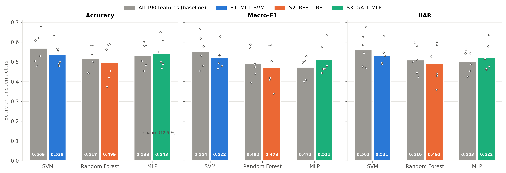
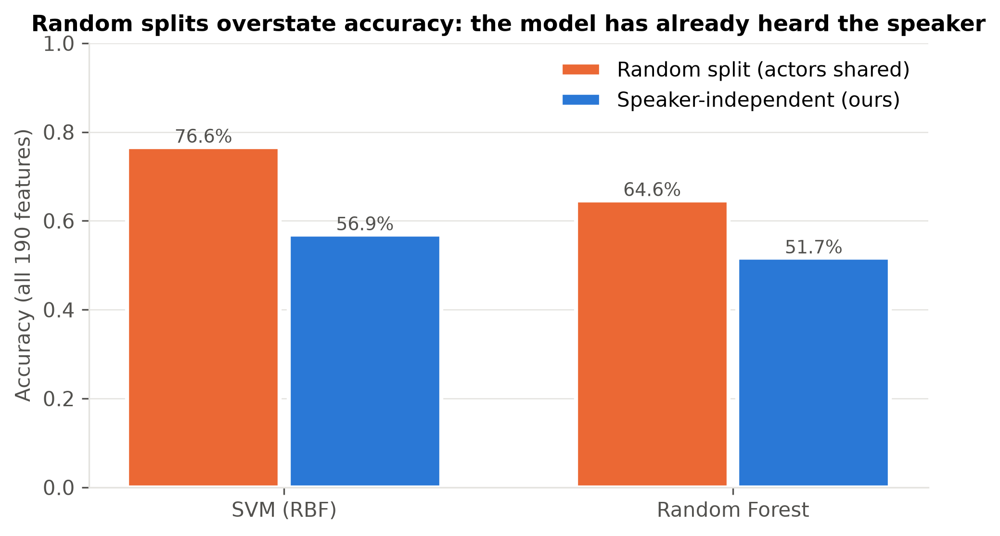

# Speaker-Independent Speech Emotion Recognition Using Acoustic Feature Selection

Pattern Recognition (CCA1) case study, Group 19:
Aryan Gavali · Godwin Thomas · Sarthak Vyavahare · Praveet Gupta

We classify short spoken sentences into eight emotions (neutral, calm, happy, sad, angry, fearful, disgust, surprised) using the RAVDESS dataset. Every model is tested on **actors it never heard during training**, and every solution uses a **feature selection algorithm**:

| Solution | Feature selection | Classifier |
|---|---|---|
| 1 | Mutual Information (filter) | SVM, RBF kernel |
| 2 | Recursive Feature Elimination (wrapper) | Random Forest |
| 3 | Genetic Algorithm (metaheuristic) | Multilayer Perceptron |

## Results

All numbers are **speaker-independent**: nested 6-fold cross-validation in which each fold tests 4 actors (2 male + 2 female) that the model never heard. Feature selection and tuning happen inside the training actors only. Values are mean ± std over the 6 folds. Chance level is 12.5 %.

| Model | Features used | Accuracy | Macro-F1 | UAR |
|---|---|---|---|---|
| SVM, all features (baseline) | 190 | 0.569 ± 0.077 | 0.554 ± 0.081 | 0.562 |
| **S1: Mutual Information + SVM** | 102 | 0.538 ± 0.060 | **0.522 ± 0.059** | 0.531 |
| Random Forest, all features (baseline) | 190 | 0.517 ± 0.066 | 0.492 ± 0.074 | 0.510 |
| **S2: RFE + Random Forest** | 67 | 0.499 ± 0.094 | 0.473 ± 0.100 | 0.491 |
| MLP, all features (baseline) | 190 | 0.533 ± 0.060 | 0.473 ± 0.054 | 0.503 |
| **S3: Genetic Algorithm + MLP** | 108 | 0.543 ± 0.072 | 0.511 ± 0.077 | 0.522 |

**Key findings**

- **Feature selection removed 43–65 % of the features.** It *improved* the MLP (+0.037 macro-F1). For the SVM and Random Forest, the compact subsets cost a few points (−0.032 and −0.019). Only the SVM drop is significant (McNemar, Holm-corrected p = 0.019).
- **S1 and S3 are both significantly better than S2** (p = 0.015 and 0.006) but cannot be separated from each other (p = 0.83).
- **Highest macro-F1 in the study:** an SVM trained on the RFE-selected features, at **0.568** vs 0.554 for the all-feature SVM. This comes from the post-hoc selector × classifier swap, and the difference was not tested for significance.
- None of the three solutions beats the all-feature SVM. S1 and S3 perform comparably.
- **k rule.** k is chosen with the one-standard-error rule, which favours smaller subsets. The plain "highest inner score" rule (first run, `results/argmax_rule/`) keeps more features and matches the baselines (S1: 183 features, F1 0.558; S2: 120 features, F1 0.490).
- **Random splits are misleading:** the same SVM scores **76.6 %** with a random split (actors shared) but **56.9 %** on unseen actors.
- **Selection stability** (mean Jaccard across folds): MI 0.60, GA 0.48, RFE 0.46.
- *Secondary, transductive analysis:* per-speaker feature normalisation raises macro-F1 to 0.57–0.62. This assumes unlabeled audio from each test speaker, so treat it as an upper bound.

<p align="center"></p>
<p align="center"></p>

## How to run

```bash
python -m venv .venv
.venv\Scripts\activate          # Windows  (Linux/macOS: source .venv/bin/activate)
pip install -r requirements.txt
pip install -e .
```

Download `Audio_Speech_Actors_01-24.zip` from [Zenodo record 1188976](https://zenodo.org/records/1188976) and extract it into `data/raw/`. You should get 24 folders `Actor_01` … `Actor_24` with 1,440 WAV files in total.

Then run the notebooks in `notebooks/` in order (01 → 06).

## Repository layout

```
data/features.csv   extracted acoustic features (one row per clip)
src/ser/            shared code used by all notebooks
notebooks/          one notebook per step: EDA, features, 3 solutions, comparison
results/            per-fold metrics and predictions
figures/            all plots
docs/               feature descriptions and viva notes
```

## Dataset and citation

RAVDESS is by Steven R. Livingstone and Frank A. Russo and is licensed under CC BY-NC-SA 4.0. We use only the audio-only speech portion (1,440 clips, 24 professional actors, 12 male and 12 female).

> Livingstone, S. R., & Russo, F. A. (2018). The Ryerson Audio-Visual Database of Emotional Speech and Song (RAVDESS): A dynamic, multimodal set of facial and vocal expressions in North American English. *PLoS ONE*, 13(5), e0196391. https://doi.org/10.1371/journal.pone.0196391

Our code is under the MIT licence (see `LICENSE`).
